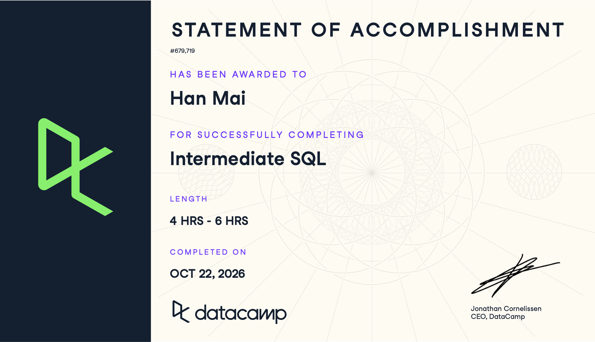

**Student:** Han Mai  
**Course:** IBM 6500 - Customer Insight Methods and Survey Research  
**Prepared for review:** October 21, 2026

## Course-Completion Evidence

I completed the assigned DataCamp Intermediate SQL course; my statement of accomplishment records **October 22, 2026** as the completion date. The completed course dashboard shows 100% for all four chapters.

{width="100%"}

These notes follow the completed AI Tutor course: Data Aggregation, Data Transformation, Data Filtering, and Conditional Operations. The examples use fictional tables, not private client records or actual CEP findings. The syntax follows the BigQuery SQL used in the course. In an actual project, I would replace short table names with the appropriate project, dataset, and table reference.

## Data Aggregation

### Summary Values

**Main ideas and syntax.** Aggregation reduces detailed rows to useful summary values. I first need to decide what each row represents and which field answers the question. `SUM(cost)` adds spending; `AVG(cost)` gives the mean; `MIN(cost)` and `MAX(cost)` show extremes. `COUNT(*)` counts rows, `COUNT(column)` counts non-null values, and `COUNT(DISTINCT column)` counts unique non-null values. `AS` gives an output a readable alias without changing the source table. The course's order-versus-user and trip-versus-rider examples showed why counting the right identifier matters.

**When to use it.** Use this pattern for an overall total, average, range, or unique count before breaking results into categories.

```sql
SELECT COUNT(*) AS daily_campaign_rows,
       COUNT(DISTINCT campaign_id) AS campaign_count,
       SUM(cost) AS total_cost,
       SUM(clicks) AS total_clicks,
       AVG(cost) AS avg_daily_campaign_cost,
       MIN(cost) AS min_daily_campaign_cost,
       MAX(cost) AS max_daily_campaign_cost
FROM campaign_performance;
```

**Explanation.** Assume one row per campaign per day, with cost in dollars. The result is one row with seven summary columns. The row count describes campaign-days, while the distinct count describes campaigns. The average is an average of daily campaign costs, not an average lifetime cost per campaign. Null costs are excluded from the numeric aggregates; they should not silently be interpreted as zero spending.

**CEP / marketing application.** I could summarize a permitted Google Ads export before evaluating individual campaigns. For a survey, I would count distinct response identifiers rather than assume the number of rows equals the number of respondents. These are descriptive totals, not evidence that clicks became consultations or patients.

### One Grouping Column

**Main ideas and syntax.** `GROUP BY` changes the output from one overall summary to one row per observed category. Every selected field that is not aggregated must be part of the grouping. `ORDER BY` sorts the resulting groups; it does not decide how groups are formed. `DESC` places large values first, while `ASC` places small values first. A descriptive alias can also be used for sorting.

**When to use it.** Use one grouping column to compare the same measure across channels, cities, devices, or another single dimension.

```sql
SELECT channel,
       COUNT(*) AS campaign_days,
       SUM(clicks) AS total_clicks,
       SUM(cost) AS total_cost
FROM campaign_performance
GROUP BY channel
ORDER BY total_cost DESC;
```

**Explanation.** Each output row represents one channel. SQL groups the daily campaign rows, calculates clicks and cost within each group, and lists the highest-spending channel first. The count helps show the amount of data behind each total. A category with no source rows will not appear automatically.

**CEP / marketing application.** This could compare channel-level activity in an authorized campaign dataset. With verified website-event data, a similar query could summarize event counts by device. I would keep the reporting period and metric definitions consistent before comparing groups.

### Multiple Grouping Columns

**Main ideas and syntax.** Grouping by several fields creates one row per observed combination. The lesson compared single-category summaries with more detailed combinations, discussed small group sizes and missing combinations, and used multiple sorting fields. `GROUP BY 1, 2` can refer to selected-column positions, but names make a reusable query easier to maintain. Adding an unrelated selected field without grouping or aggregating it causes an error. Grouping can also use a field that is not displayed, although displaying the group labels usually makes verification clearer.

**When to use it.** Use this pattern when an overall comparison may hide differences between locations or other dimensions. Avoid adding so many dimensions that each result is supported by only a few records.

```sql
SELECT city, channel,
       COUNT(*) AS campaign_days,
       SUM(clicks) AS total_clicks,
       SUM(cost) AS total_cost
FROM campaign_performance
GROUP BY city, channel
ORDER BY city ASC, total_cost DESC;
```

**Explanation.** The result contains a separate row for each city-channel combination present in the data. Cities are alphabetical, and channels within each city are ordered by spending. A total for one combination is not the total for the whole city. Missing city-channel pairs are absent, rather than proof of zero activity.

**CEP / marketing application.** I could compare survey response counts by city and recruitment source, or campaign activity by location and channel. San Gabriel and Chino Hills would remain separate contexts; this example does not establish that comparable observations exist for both locations.

## Data Transformation

### Basic Transformations

**Main ideas and syntax.** A transformation calculates a new value for each row instead of collapsing rows. Arithmetic operators `+`, `-`, `*`, and `/` combine columns; parentheses control the calculation. Ratios need a clearly defined denominator and unit. The course used currency conversion, net-sale calculations, conversion rates, cost per order, `NULLIF`, and `SAFE_DIVIDE` to address zero denominators. In BigQuery, `SAFE_DIVIDE(numerator, denominator)` returns null when division would fail, while `numerator / NULLIF(denominator, 0)` makes a zero denominator null.

**When to use it.** Create a derived field when the raw table contains the ingredients for a metric but not the metric itself.

```sql
SELECT campaign_id, report_date, cost, clicks,
       SAFE_DIVIDE(cost, clicks) AS cost_per_click,
       100 * SAFE_DIVIDE(clicks, impressions) AS ctr_percent
FROM campaign_performance;
```

**Explanation.** The output retains one row per campaign-day and adds CPC in dollars per click and CTR as a percentage. If clicks are zero, CPC is null rather than a misleading zero. If impressions are zero, CTR is null. These are illustrative metrics based on the example table's definitions. To summarize several rows, I would divide total cost by total clicks, not take an unweighted average of the row-level CPC values.

**CEP / marketing application.** These fields could help compare campaign efficiency in a Google Ads export. A missing or undefined rate would need investigation. An inexpensive click does not establish lead quality, and a click-based calculation cannot validate GA4 tracking.

### Complex Transformations

**Main ideas and syntax.** Multi-step calculations are easier to follow when intermediate results have names. A common table expression starts with `WITH name AS (...)` and can be used by the main query. An alias created in a SELECT list generally cannot be reused by another expression in that same SELECT list; a CTE separates the stages. The lesson also used scalar subqueries for percentage-of-total calculations and `ROUND(value, 2)` for readable output. Rounding should normally be the final presentation step.

**When to use it.** Use a CTE when a metric depends on an earlier calculation, or when separating aggregation from ratios will make the denominator easier to check.

```sql
WITH channel_totals AS (
  SELECT channel, SUM(cost) AS total_cost,
         SUM(clicks) AS total_clicks
  FROM campaign_performance
  GROUP BY channel
)
SELECT channel, total_cost, total_clicks,
       ROUND(SAFE_DIVIDE(total_cost, total_clicks), 2) AS cpc,
       ROUND(100 * SAFE_DIVIDE(
         total_cost,
         (SELECT SUM(total_cost) FROM channel_totals)
       ), 2) AS spend_share_percent
FROM channel_totals;
```

**Explanation.** The CTE first creates one row per channel. The main query calculates CPC from summed cost and clicks, then divides each channel's cost by the total cost across all channels in that CTE. The scalar subquery supplies one denominator. Shares should total approximately 100% when spending is valid and positive, allowing for rounding. The CTE is a temporary query result, not a permanently saved database table.

**CEP / marketing application.** I could report the share of a defined campaign budget used by each channel, or adapt the same pattern to survey response shares. The denominator must describe the same eligible records and time period as the numerator. I would not combine historical San Gabriel spending with a future Chino Hills plan as if both were observed campaign results.

## Data Filtering

### Basic Filtering

**Main ideas and syntax.** `WHERE` keeps rows whose condition evaluates to true. Comparisons include `=`, `!=`, `<`, `<=`, `>`, and `>=`. Text literals use single quotes. The course used `LIKE` with `%` for text patterns: `'Search%'` matches a prefix, `'%Search'` a suffix, and `'%Search%'` a contained phrase. Missing values require `IS NULL` or `IS NOT NULL`, not `= NULL`. A null value means missing or unknown, not necessarily zero or an empty string.

**When to use it.** Filter the input to the records relevant to the question, and check missingness before treating a dataset as complete.

```sql
SELECT response_status, city, COUNT(*) AS response_count
FROM survey_responses
WHERE city IS NOT NULL
GROUP BY response_status, city;
```

**Explanation.** Assume one fictional survey response per row. This returns counts by status and city for responses with a non-null city. It does not remove blank city strings or guarantee that a response is complete. A separate condition would be needed for those rules. To inspect missing locations instead, I would use `WHERE city IS NULL`.

**CEP / marketing application.** This could identify which survey records can support a location comparison. Pattern filters could isolate a consistently named campaign family. I would retain an audit of excluded records so filtering does not hide a data-quality problem.

### Multiple Conditions

**Main ideas and syntax.** `AND` requires all connected conditions to be true; `OR` accepts either. `IN (...)` is a concise way to match one field against several values. SQL evaluates AND before OR, so parentheses are essential when several alternatives should share another requirement. A condition that evaluates to null is not kept by WHERE.

**When to use it.** Combine eligibility rules such as location and completion status, or alternative categories that must satisfy a shared rule.

```sql
SELECT city, COUNT(*) AS complete_responses
FROM survey_responses
WHERE response_status = 'Complete'
  AND (city = 'San Gabriel' OR city = 'Chino Hills')
GROUP BY city;
```

**Explanation.** Each returned row is a city with complete responses in the fictional table. The parentheses make the two-city condition apply together. Without them, an OR branch could admit Chino Hills records regardless of status. `city IN ('San Gabriel', 'Chino Hills')` is an equivalent, shorter location test here.

**CEP / marketing application.** This could define an eligible survey subset if both locations are actually included in an approved study. I would verify that the location field measures the intended concept, such as residence, rather than assume it means treatment location or campaign exposure.

### Complex Filtering

**Main ideas and syntax.** Complex filters can be broken into boolean helper columns and then applied in a separate query. WHERE runs before SELECT, so helper aliases created in SELECT are not available to WHERE in the same query. A CTE solves that problem. `NOT(condition)` reverses a condition; parentheses ensure it reverses the whole intended expression. The lesson also combined `ORDER BY` and `LIMIT` for top or bottom N results and checked included rows, excluded rows, and counts.

**When to use it.** Use named flags when a question combines several thresholds or when reviewers need to see why a record was included.

```sql
WITH campaign_flags AS (
  SELECT campaign_id, cost, clicks,
         cost > 100 AS is_high_cost,
         SAFE_DIVIDE(cost, clicks) > 5 AS is_high_cpc
  FROM campaign_performance
)
SELECT campaign_id, cost, clicks, is_high_cost, is_high_cpc
FROM campaign_flags
WHERE is_high_cost AND is_high_cpc
ORDER BY cost DESC
LIMIT 10;
```

**Explanation.** The CTE adds two inspection flags to each campaign-day. The main query returns up to ten rows meeting both thresholds, sorted by cost. These are the highest-cost matching rows, not necessarily ten distinct campaigns. Zero-click rows have null CPC and do not pass the filter. `NOT(is_high_cost AND is_high_cpc)` returns the false cases, but null cases may remain unknown; original and opposite counts only partition the whole table when the relevant condition has no unknown outcomes. I would check nulls separately.

**CEP / marketing application.** This could flag expensive campaign-days for review while exposing the rules behind the decision. It would prioritize investigation, not automatically prove poor performance. For future BigQuery work, I could inspect small samples of included and excluded rows before relying on a large summary.

## Conditional Operations

### Conditional Transformation

**Main ideas and syntax.** `CASE WHEN condition THEN value ELSE other_value END` creates a value according to each row's conditions. With several WHEN branches, the first true condition wins. That order matters for overlapping thresholds. An omitted ELSE returns null for unmatched rows. The lesson used conditional distance conversion, classification, occupancy categories, category shares, and chained CTEs. Multiple CTEs use WITH once and commas between definitions; later CTEs can refer to earlier ones.

**When to use it.** Use CASE to standardize values, create reusable categories, or bin numeric measures into ranges before grouping.

```sql
WITH categorized AS (
  SELECT CASE
           WHEN cost >= 500 THEN 'High'
           WHEN cost >= 100 THEN 'Medium'
           WHEN cost IS NULL THEN 'Unknown'
           ELSE 'Low'
         END AS spend_category
  FROM campaign_performance
)
SELECT spend_category, COUNT(*) AS campaign_days
FROM categorized
GROUP BY spend_category;
```

**Explanation.** The output has one row per observed spending category, with a count of campaign-days. The highest threshold comes first so a cost of 600 is High rather than Medium. Missing cost is labeled Unknown instead of being placed in Low. This example assumes nonnegative cost in dollars; the thresholds are illustrative decisions, not universal marketing standards. A later CTE could calculate each category's percentage of all rows.

**CEP / marketing application.** I could create understandable reporting categories for campaign spending or survey intent. Definitions should be agreed before interpreting results, and missing responses should remain distinct from low intent. Categorization does not create evidence of actual qualified leads.

### Conditional Aggregation

**Main ideas and syntax.** Conditional aggregation keeps a group intact while only selected values contribute to a particular metric. The course placed `CASE WHEN` inside `AVG`, `COUNT`, and `SUM`. Unmatched values become null when ELSE is omitted, and these aggregates ignore them. Using ELSE 0 inside an average would include zeroes and change the denominator. WHERE filters source rows before grouping; `HAVING` filters completed groups using their aggregates. The working sequence is FROM, WHERE, GROUP BY, HAVING, SELECT, then ORDER BY.

**When to use it.** Use this pattern when one grouped report needs an overall metric plus metrics for a subset. Do not put a subset-only condition in WHERE if other metrics need all eligible rows.

```sql
SELECT channel,
       COUNT(*) AS campaign_days,
       SUM(cost) AS total_cost,
       COUNT(CASE WHEN clicks > 0 THEN 1 END) AS days_with_clicks,
       AVG(CASE WHEN clicks > 0 THEN cost / clicks END)
         AS avg_daily_cpc_on_click_days,
       SUM(CASE WHEN clicks > 0 THEN cost END)
         AS cost_on_click_days
FROM campaign_performance
WHERE cost IS NOT NULL
GROUP BY channel
HAVING COUNT(*) >= 5;
```

**Explanation.** The result contains channels with at least five rows whose costs are known. Overall cost uses all those rows, including zero-click days. The conditional count, average, and sum use only days with clicks. The average is explicitly an unweighted daily CPC average; an overall channel CPC would instead use `SAFE_DIVIDE(SUM(cost), SUM(clicks))`. If no row matches a conditional sum or average, its result is null, whereas the conditional count is zero.

**CEP / marketing application.** I could compare all eligible survey responses with high-intent responses in the same summary, or calculate permitted campaign metrics for a defined subset. In future GA4/BigQuery analysis, the same logic could compare selected events with all relevant events after the event schema and tracking are verified. A response or event would count as a valid inquiry only under an explicit, checked definition.

## Overall Reflection and Series Synthesis

The patterns I expect to use most are grouping, safe division, CTEs, and CASE inside an aggregate. They let me move from a list of records to a comparison I can explain. The distinction between counting records and counting unique people is especially useful for survey and customer data. In the Summary Values lesson, confusing an order identifier with a user identifier showed why choosing the right field comes before choosing the function.

The most demanding part was keeping the query's logic and denominator straight. AND/OR precedence, aliases that are not yet available, and null values can change a result even when a query looks reasonable. I worked through these patterns by separating conditions into flags, using a CTE for intermediate results, checking included and excluded rows, and comparing the output with the question. The course's deliberate alias-error examples were helpful because they showed why repeating an alias in WHERE does not work. I would also check zero-click rows separately instead of treating undefined CPC as zero.

Introduction to SQL gave me the basic language for selecting data and understanding tables. Intermediate SQL extended that into grouped summaries, derived metrics, multi-condition filters, and conditional calculations. Introduction to BigQuery provides the environment where I could apply these patterns to larger datasets. I could start with a clearly defined table and grain, restrict the relevant records, and then calculate grouped measures. Before using a GA4 export, I would still need to understand its nested event structure and verify that the required data is actually available.

For digital marketing and the CEP, these techniques could support campaign comparisons, survey quality checks, location-specific summaries, and intent categories. They do not establish attribution, incrementality, qualified leads, bookings, or patient outcomes by themselves. The fictional examples here are practice patterns; any real conclusion would need appropriate access, a defensible metric definition, and verified source data.

I expect to return to the aggregation examples when checking totals, the transformation notes when defining ratios, and the filtering and CASE sections when building a reusable report. I would also consult the BigQuery report for table structure and platform-specific work, and the Introduction to SQL report for basic syntax. Keeping the three reports in one portfolio gives me a reference I can adapt instead of starting each query from scratch.

## Appendix: Publication Links

### GitHub repository

[GitHub repository](https://github.com/hanamai111/ibm-6500-sql-learning-portfolio)

### Published Intermediate SQL report

[Published Intermediate SQL report](https://hanamai111.github.io/ibm-6500-sql-learning-portfolio/intermediate-sql.html)

This report belongs to the same SQL and BigQuery portfolio as the two earlier reports.

### Portfolio landing page

[Portfolio landing page](https://hanamai111.github.io/ibm-6500-sql-learning-portfolio/)
